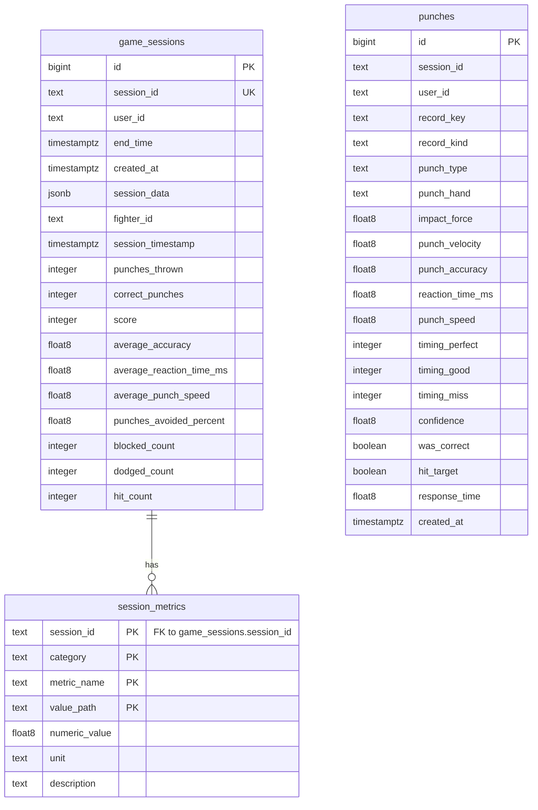

# Azure PostgreSQL Relational Schema

The backend persists completed game sessions and their normalized metrics and punch records in Azure Database for PostgreSQL. Persistence uses psycopg and versioned SQL migrations; there is no ORM or application-managed database cache.

## Database Configuration

| Service/Module | DB Type | Profile | Driver | Connection | Migration Tool |
|---|---|---|---|---|---|
| `perfectpunch_backend` | PostgreSQL | Azure; local development uses the same configured database when `DATABASE_URL` is set | psycopg 3 | `DATABASE_URL`; TLS is required by default | `perfectpunch_backend/db/apply_migrations.py` applies SQL files in `perfectpunch_backend/db/migrations/` |

## Data Ownership per Service

| Service | Tables Owned | ORM Framework | Caching | Notes |
|---|---|---|---|---|
| `perfectpunch_backend` | `game_sessions`, `session_metrics`, `punches` | None; parameterized psycopg SQL | None found | User identity is supplied by Microsoft Entra ID; there is no local user table |

## Entity Model

The following ER diagram shows database-enforced relationships. `punches.session_id` is populated by the session service, but the current migrations do not declare it as a foreign key.

<!-- mermaid-checked: every attribute is `<type> <name> [<key>] ["<description>"]` with at most one of PK/FK/UK, no \n in descriptions, no {} in descriptions, every relationship label is double-quoted -->

### Table details

| Table | Columns and constraints |
|---|---|
| `game_sessions` | `id BIGINT GENERATED BY DEFAULT AS IDENTITY PRIMARY KEY`; `session_id TEXT NOT NULL UNIQUE`; `user_id TEXT NOT NULL`; nullable `end_time TIMESTAMPTZ`, `session_data JSONB`, `fighter_id TEXT`, `session_timestamp TIMESTAMPTZ`, and summary columns `punches_thrown INTEGER`, `correct_punches INTEGER`, `score INTEGER`, `average_accuracy DOUBLE PRECISION`, `average_reaction_time_ms DOUBLE PRECISION`, `average_punch_speed DOUBLE PRECISION`, `punches_avoided_percent DOUBLE PRECISION`, `blocked_count INTEGER`, `dodged_count INTEGER`, `hit_count INTEGER`; `created_at TIMESTAMPTZ NOT NULL DEFAULT CURRENT_TIMESTAMP`. Indexes: `(session_id, end_time DESC)` and `(user_id, created_at DESC)`; `session_id` also has a unique index. |
| `session_metrics` | `session_id TEXT NOT NULL` references `game_sessions(session_id) ON DELETE CASCADE`; `category TEXT NOT NULL`, `metric_name TEXT NOT NULL`, `value_path TEXT NOT NULL`; nullable `numeric_value DOUBLE PRECISION`, `unit TEXT`, `description TEXT`. Composite primary key: `(session_id, category, metric_name, value_path)`. |
| `punches` | `id BIGINT GENERATED BY DEFAULT AS IDENTITY PRIMARY KEY`; `punch_type TEXT NOT NULL`; nullable `punch_hand TEXT`, `impact_force DOUBLE PRECISION`, `punch_velocity DOUBLE PRECISION`, `session_id TEXT`, `user_id TEXT`, `record_key TEXT`, `record_kind TEXT`, `punch_accuracy DOUBLE PRECISION`, `reaction_time_ms DOUBLE PRECISION`, `punch_speed DOUBLE PRECISION`, `timing_perfect INTEGER`, `timing_good INTEGER`, `timing_miss INTEGER`, `confidence DOUBLE PRECISION`, `was_correct BOOLEAN`, `hit_target BOOLEAN`, `response_time DOUBLE PRECISION`; `created_at TIMESTAMPTZ NOT NULL DEFAULT CURRENT_TIMESTAMP`. Partial unique index on `(session_id, record_key)` when both are non-null, plus an index on `session_id`. |

`session_data` stores the complete dashboard-shaped payload as JSONB when the saved payload contains a `summary`; otherwise it is null and summary fields are stored in columns. `session_metrics` flattens numeric leaves from the nested `metrics` object into rows, retaining category, metric name, value path, unit, and description. `punches` stores per-attempt rows or per-punch-type aggregate rows from metrics. The legacy direct insert path may also create a punch row without a session.

## Key Repository Methods

| Service | Repository / source | Notable methods | Purpose |
|---|---|---|---|
| `perfectpunch_backend` | `game_session_service.py` | `save_game_session(data, user_id)` | Upserts a user-owned session and replaces its normalized metric and punch rows. |
| `perfectpunch_backend` | `game_session_service.py` | `get_game_session(session_id, user_id)`, `get_latest_session(user_id)`, `list_game_sessions(user_id)` | Reads sessions scoped to the verified user; listing is capped at 100. |
| `perfectpunch_backend` | `db/apply_migrations.py` | `main()` | Applies the ordered SQL migrations to the configured PostgreSQL database. |

## Caching Strategy

No database, query-result, or application cache for persisted session data was found. Active game state is maintained in process memory and is separate from PostgreSQL persistence.

## Data Ownership Boundaries

The backend uses one shared PostgreSQL database. `game_sessions` is the parent for `session_metrics`, enforced by a foreign key with cascading deletion. Punch records carry `session_id` and are indexed and rewritten alongside their session by the service, but the database currently does not enforce that relationship. Session reads and writes are filtered by the verified Entra user ID (`oid`); no database user table or cross-service database access was found. The existing migration files are authoritative and are run with `python -m perfectpunch_backend.db.apply_migrations`.

### Data Classification & Sensitivity

| Entity | Sensitive Fields | Classification | Controls in Place |
|---|---|---|---|
| `game_sessions` | `user_id` is an Entra object identifier; `session_data` can contain session identifiers and performance data | Pseudonymous identifier and behavioral/performance data; no names, email, address, or payment data identified | Database queries are scoped to the verified user ID. No field-level encryption or masking was found in the application schema. Azure PostgreSQL encryption-at-rest settings are outside this repository. |
| `session_metrics` | Session-linked performance metrics and descriptive metadata | Behavioral/performance data | Session rows are user-scoped at the service layer; no field-level encryption or masking was found. |
| `punches` | Session-linked punch classification, confidence, accuracy, and timing data; optional `user_id` | Behavioral/performance data | Session reads are user-scoped in the session service. The `punches` table does not have a database-enforced foreign key to `game_sessions` or user. No field-level encryption or masking was found. |
